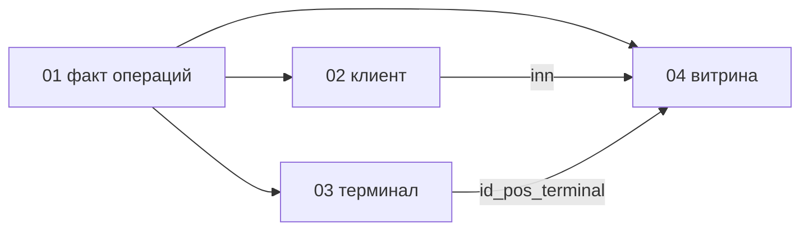

# Витрина транзакций торгового эквайринга (ТЭ)

Задача AI-14134. Витрина для анализа транзакционного потока ТЭ в разрезах (AI-14135).

- Итоговая таблица: `sandbox_ai.tmp_shestopalov_acq_mart`.
- Зерно: одна строка = одна операция.
- Окно: август–октябрь 2026. Октябрь собран раньше и не пересобирается: `01_te_trx` дописывает в факт месяцы из списка `MONTHS` (август и сентябрь), каждый месяц — отдельный запрос. Перед записью ячейка проверяет, что этих месяцев в факте ещё нет. Сборка с нуля — `REBUILD_ALL = True` и октябрь в `MONTHS`.
- Объём за один октябрь 2026, до дозагрузки августа и сентября: 7 338 607 операций, 5001 ИНН, 5047 договоров, 7978 терминалов.

## Состав и порядок сборки

Витрина собирается из трёх таблиц. Каждая таблица — своя тетрадка, рядом лежит тот же SQL в папке `sql/`.

| № | Тетрадка | SQL | Таблица | Зерно |
|---|---|---|---|---|
| 1 | `01_te_trx.ipynb` | `sql/01_te_trx.sql` | `sandbox_ai.tmp_shestopalov_acq_trx` | операция |
| 2 | `02_te_client.ipynb` | `sql/02_te_client.sql` | `sandbox_ai.tmp_shestopalov_acq_clients` | ИНН |
| 3 | `03_te_terminal.ipynb` | `sql/03_te_terminal.sql` | `sandbox_ai.tmp_shestopalov_acq_terminals` | терминал |
| 4 | `04_te_mart.ipynb` | `sql/04_te_mart.sql` | `sandbox_ai.tmp_shestopalov_acq_mart` | операция |

Запуск строго по порядку: 01, затем 02 и 03, затем 04.

- 02 и 03 берут список ИНН и терминалов из факта. Если факт пуст, тетрадки останавливаются.
- 04 перед сборкой проверяет, что в клиенте и терминале нет дублей ключа. После сборки проверяет, что строк в витрине столько же, сколько в факте.
- Каждая тетрадка пересоздаёт свою таблицу (`drop table if exists` и `create table as`).

Чтобы собрать витрину за другой месяц, поменяйте даты в `01_te_trx`. Даты стоят в трёх местах: в `sa_agr` дважды (действие договора и POS-условия) и в `trx_base_raw` (окно операций). Остальные тетрадки перезапустите без изменений.

## Периметр и отбор операций

Периметр и отбор взяты из DAG `acq_final_df`: файлы `acq_01_sa_perimeter.sql` и `acq_05_trx_agr.sql`.

**Договор** попадает в периметр, если:
- это договор торгового эквайринга: `ods_alpha.scd1_agreements.acq_class = 'SA'`;
- договор действует хотя бы один день в месяце: `ods_alpha.scd1_agreements.d_valid_from` и `d_valid_to`;
- на договоре есть POS-условие, действующее в этом месяце: `ods_alpha.scd1_agr_terms.cf_ter_type = 'P'`;
- договор и компания (`ods_alpha.scd1_companies`) не удалены, ИНН компании заполнен.

**Операция** (`ods_alpha.scd1_trx`) попадает в факт, если:
- эквайер — РСХБ: `ods_alpha.scd1_trx.c_fiid_acq` входит в группу `RSHB` справочника `ods_alpha.scd1_base24_fiids` (`c_fiid_grp`);
- терминал заполнен (`c_nter`), класс операции `SA` (`c_trx_class`), операция не удалена (`ods_deleted_flg`);
- тип операции `S01` — покупка (`c_trx_type`);
- операция связана с договором из периметра через `ods_alpha.scd1_trx_acq`.

**Отличие от DAG одно:** DAG дополнительно исключает отменённые операции (статус `R`), а витрина их оставляет. Подробнее — в разделе «Особенности».

## Атрибуты витрины

### Операция (факт, `01_te_trx`)

| Атрибут | Источник | Логика |
|---|---|---|
| `inn` | `ods_alpha.scd1_companies.c_inn` | ИНН компании договора. Только цифры: пробелы и прочие символы удалены |
| `id_pos_terminal` | `ods_alpha.scd1_trx.c_nter` | Номер терминала |
| `mcc_code` | `ods_alpha.scd1_trx.n_mcc` | MCC чека. Код, под которым прошла покупка |
| `mcc_terminal` | `ods_alpha.scd1_merchants.n_mcc` | MCC торговой точки. Связь по `c_nmrc` = `retl_id`. На самом POS-терминале кода нет |
| `mcc_profile` | `ods_alpha.scd1_merchants.c_mrc_profile` | Профиль точки. Им склеиваются MCC вне топ-10 |
| `mcc_mismatch` | оба кода | 1, если код точки и код чека заполнены и не равны. Пустой код расхождением не считается |
| `transaction_id` | `ods_alpha.scd1_trx.n_trx` | Идентификатор операции, уникален в витрине |
| `date_t` | `ods_alpha.scd1_trx.d_trx_orig` | Дата и время операции |
| `sum_t` | `ods_alpha.scd1_trx.n_amt_src` | Сумма операции |
| `status` | `ods_alpha.scd1_trx.cf_trx_stat` | Статус: `N` — обычная, `R` — отменённая, `D` — см. «Особенности» |
| `card_bin` | `ods_alpha.scd1_trx.n_bin` | BIN карты строкой. Длина 6, 7, 8 или 9 цифр в зависимости от платёжной системы |
| `type_t` | `ods_alpha.scd1_trx.c_trx_type` | Тип операции. В витрине всегда `S01` |
| `payment_system` | `ods_alpha.scd1_trx.n_bin` | Платёжная система по началу BIN, правило ниже |
| `n_agr` | `ods_alpha.scd1_trx_acq.n_agr` | Договор операции. Если операция связана с несколькими договорами периметра, берётся минимальный номер |
| `retl_id` | `ods_alpha.scd1_trx.c_nmrc` | Торговая точка. Строка, ведущие нули сохранены |
| `mrc_city` | `ods_alpha.scd1_trx.c_mrc_city` | Город торговой точки латиницей, как в процессинге |

Правило `payment_system`:

| Начало BIN | Значение |
|---|---|
| `2200`–`2204` | МИР |
| `4` | Visa |
| `51`–`55`, `2221`–`2720` | Mastercard |
| `62` | UnionPay |
| остальное | прочие |

Карты РСХБ тоже разделяются по платёжной системе: в BIN наших карт есть и «Мир», и Visa, и Mastercard, и UnionPay. Отдельной группы «Карта РСХБ» в витрине нет.

### Клиент (`02_te_client`)

Одна строка на ИНН из факта. Если у ИНН несколько договоров, атрибуты сводятся через `max`, дата текущего договора — через `min`. По октябрю 2026 из 5001 ИНН несколько договоров у 45, договоры в разных филиалах — у 4: у них в `filial` остаётся один филиал из двух. Город точки при этом не теряется: он хранится в каждой операции (`mrc_city`), точки в разных городах есть у 205 ИНН.

Цепочка ЦФТ, через которую берётся большинство атрибутов: договор `ods_alpha.scd1_agreements.abs_agr_id` = `ods.scd1_z_r2_ip_merchants.id`, затем клиент ЦФТ `ods.scd1_z_r2_ip_merchants.c_cl_org` = `ods.scd1_z_client.id` = `ods.scd1_z_cl_corp.id`.

| Атрибут | Источник | Логика |
|---|---|---|
| `okved` | `ods.scd1_z_client.c_okved_in_period` → `ods.scd1_z_okved_period.c_okved` → `ods.scd1_z_okved.c_code` | Основной ОКВЭД: действующий период (`ods.scd1_z_okved_period.c_date_end` пуст) с признаком основного (`c_main = '1'`). Как в `features` DAG техлида |
| `okopf` | `ods.scd1_z_cl_corp.c_forma` → `ods.scd1_z_form_property.c_short_name` | Сокращение орг.формы: ООО, АО, ПАО, ГКФХ, ГБУ и т. д. Если в справочнике пусто и ИНН из 12 цифр — `ИП` |
| `region` | `ods.scd1_z_client.c_okato_code` | Первые 2 цифры ОКАТО: регион регистрации клиента. 45 — Москва, 46 — Московская обл., 40 — Санкт-Петербург, 41 — Ленинградская обл. |
| `filial` | `ods.scd1_z_r2_ip_merchants.c_depart` → `ods.scd1_z_depart.c_filial` → `ods.scd1_z_branch.c_shortlabel` | Филиал РСХБ, который ведёт договор. Как `filial_rf` в `acq_06_cft_attrs.sql` |
| `ssp_ocrm` | `ocrm_ul.s_org_ext.x_area_resp` | Зона ответственности (сегмент) из OCRM, связь по ИНН (`ocrm_ul.s_org_ext.x_inn`). Отбор записи — как в `acq_02_cdi_map.sql`, приведение значений — как в `datamart_month_acquiring_v3.ipynb`, правило ниже |
| `business_size` | `ssp_ocrm` | Размер для разрезов AI-14135. ДМ — Мелкий, ДМСБ — Средний, ДКБ — Крупный. ДРПА, «не подлежит сегментации» и пустая ЗО — «нет ЗО» |
| `business_size_is_proxy` | константа 0 | Размер взят из зоны ответственности, а не из терциля оборота. Оборот и число операций в тестах этого разреза остаются |
| `ogrn` | `ods.scd1_z_cl_corp.c_register_gos_reg_num_rec` | ОГРН или ОГРНИП. Как в `acq_06_cft_attrs.sql` |
| `jur_address` | `ods_alpha.scd1_companies.c_jur_address` | Юридический адрес |
| `date_acquiring` | `ods_alpha.scd1_agreements.d_valid_from` | Первое подключение: самая ранняя дата начала договора SA этого ИНН среди всех его договоров, включая закрытые и договоры без операций в месяце |
| `date_agr_current` | `ods_alpha.scd1_agreements.d_valid_from` | Начало текущего договора: самая ранняя дата начала среди договоров, по которым были операции в факте |

Правило `ssp_ocrm`. В OCRM названия обрезаны, поэтому значения распознаются по началу строки:

| Начало `ocrm_ul.s_org_ext.x_area_resp` | `ssp_ocrm` | Размер бизнеса для AI-14135 |
|---|---|---|
| «ДМСБ (ми…», «ДММБ…» | ДМ | Мелкий |
| «ДМСБ (ма…», «ДМСБ (ср…», «ДСБ…» | ДМСБ | Средний |
| «ДКБ…» | ДКБ | Крупный |
| «ДРПА…», «ДРА…» | ДРПА | нет ЗО |
| «не под…» | Не подлежит сегментации | нет ЗО |

Если у ИНН несколько записей в OCRM, берётся последняя созданная, без удалённых и дублей.

### Терминал (`03_te_terminal`)

Одна строка на терминал из факта. Логика — из `acq_04a_amortization.sql` DAG.

| Атрибут | Источник | Логика |
|---|---|---|
| `version` | `dwh.bmrt_bm_det_device.model_device` | Модель устройства: PAX S300, D230 и т. д. Ищется сначала по `dwh.bmrt_bm_det_device.id_device`, затем по `code_device`. Номер терминала приводится к общему виду: числа без ведущих нулей, буквы в верхнем регистре |
| `date_on` | `ods_alpha.scd1_pos_terminals.d_ter_install` | Дата установки |
| `date_off` | `ods_alpha.scd1_pos_terminals.d_ter_close` | Дата снятия. Пусто, если терминал работает |

Связь с фактом: `ods_alpha.scd1_pos_terminals.c_nter` = `id_pos_terminal`. Если у терминала несколько записей в `ods_alpha.scd1_pos_terminals`, берётся последняя: с самой поздней датой установки, затем снятия, затем по серийному номеру.

## Сверка с DAG за октябрь 2026

Сравнение с историей DAG `sandbox_ai.shestopalov_acq_final_df_hist` (`report_month = '2026-10'`). Операции со статусом `R` для сверки исключены, как в DAG.

| Показатель | DAG | Витрина без `R` |
|---|---|---|
| Операций | 7 329 750 | 7 329 750 |
| Оборот | 5,33 млрд руб. | 5,33 млрд руб. |
| ИНН с операциями | 4917 | 4917 |
| Договоров с операциями | 4962 | 4962 |
| ИНН только в одном источнике | — | 0 |

Почему ИНН и терминалов в витрине меньше, чем в периметре DAG:

- **ИНН.** В периметре DAG 6476 ИНН: все клиенты с действующим договором. Витрина строится от операций, поэтому 1559 клиентов без операций в месяце в неё не попадают.
- **Терминалы.** `term_cnt` в DAG (10 478) — все терминалы, закреплённые за договорами, включая простаивающие. В витрине только терминалы с операциями.

## Особенности

**Отменённые операции (статус `R`).** В витрине 8857 отменённых операций, это 0,1%. DAG и дашборд их исключают: денег по ним клиент не получил. Из-за них в витрине 84 ИНН и 195 терминалов, у которых в месяце не было ни одной обычной операции. Отсюда 5001 ИНН в витрине против 4917 в DAG.

Как учитывать:
- анализ потока, обороты, сравнение с дашбордом — с фильтром `status <> 'R'`;
- профиль точки — со всеми статусами: доля успешных операций считается как доля статуса `N`.

Смысл статуса `D` не сверялся. Таких операций в месяце две.

**Регион: регистрация или место бизнеса.** В витрине три географических атрибута, и они могут не совпадать:
- `region` — регион регистрации клиента по ОКАТО;
- `filial` — филиал банка, который ведёт договор;
- `mrc_city` — город торговой точки.

Например, у ИП с регистрацией в Москве (`region` = 45) точка может работать в Пермском крае: тогда `filial` — Пермский, `mrc_city` — POLAZNA. Разрез региона в профиле берёт регистрацию: `04` Красноярский край и `45` Москва остаются как есть, все прочие коды и пустой регион сворачиваются в «прочие». Московская область (`46`) в Москву не входит. Эти два региона выбраны потому, что за октябрь 2026 они на первом и втором месте и по общему обороту, и по среднему обороту на клиента: Красноярский край — 1,32 млрд ₽ на 177 клиентов, около 7,5 млн на клиента; Москва — 360 млн ₽ на 116 клиентов, около 3,1 млн на клиента. Лист `регионы` в выгрузке `07` показывает эти места и за три месяца. В `filial` Москву и область ведёт ЦРМБ, Санкт-Петербург и Ленобласть — Санкт-Петербургский филиал.

**`okopf`.**
- ИП нет в `ods.scd1_z_cl_corp`, это таблица юрлиц, поэтому им проставляется `ИП` по длине ИНН (12 цифр).
- У части клиентов форма в справочнике ЦФТ противоречит длине ИНН. Например, ИНН из 10 цифр с формой «ИП». Это ошибка источника, в витрине она не исправляется.
- Форма «Нота…» (около 15 ИНН) обрезана в источнике, как и `ssp_ocrm`.
- ГКФХ (глава крестьянского хозяйства) по смыслу близок к ИП, но в витрине это отдельная форма.

**Обрезанные русские названия.** Текстовые колонки фиксированной длины Impala обрезает по байтам. Кириллическая буква занимает 2 байта, поэтому последняя буква может оборваться. Это затрагивает `ocrm_ul.s_org_ext.x_area_resp` и часть сокращений форм в `ods.scd1_z_form_property.c_short_name`. Для `ssp_ocrm` это обходится разбором по началу строки.

**BIN.** `ods_alpha.scd1_trx.n_bin` в источнике хранится числом (`decimal(11,0)`), в витрине он строка. Разная длина BIN — не ошибка:
- 8 цифр — «Мир» и часть UnionPay;
- 6 цифр — Visa, Mastercard, China UnionPay в старом формате;
- 7 и 9 цифр — UnionPay.

Проверено: начало BIN во всех случаях соответствует эмитенту из `ods_alpha.scd1_trx.c_fiid_iss` (название — `ods_alpha.scd1_base24_fiids.c_fiid_desc`). Ведущий ноль не теряется: BIN с нуля не начинаются.

**«прочие» в `payment_system`.** Около 0,3% операций. Это карты, которые проходят через сеть «Мира», но выпущены в других системах: BIN на `35` (JCB), `67`, `9112` («Белкарт»). При необходимости их можно выделить отдельными строками в правиле.

**MCC.** В факте два кода. `mcc_code` — код чека (`ods_alpha.scd1_trx.n_mcc`). `mcc_terminal` — код торговой точки (`ods_alpha.scd1_merchants.n_mcc` по `c_nmrc`). К операциям он присоединяется после записи черновика, по списку точек `retl_id`, без повторного чтения `scd1_trx`. В DAG поле `mcc` — третий смысл: список MCC всех точек компании через запятую. Для разрезов клиента берётся мода кода точки по успешным покупкам (статус не `R`). `mcc_mismatch` отмечает операцию, где оба кода заполнены и разошлись: анкета 5411, чек 5300. Доля таких операций у клиента — `mcc_mismatch_share`. Сами пары кодов профиль не смешивает со срезом: тетрадка `05_te_profile.ipynb` (тот же SQL в `sql/05_te_profile.sql`) печатает их отдельным запросом, `te_trx_analysis.py` пишет `mcc_mismatch_pairs.csv`.

Группа MCC считается на профиле, не в факте. Десять кодов точки с наибольшим оборотом успешных покупок остаются отдельными кодами. Остальные склеиваются по `mcc_profile`. У кода без профиля группа равна самому коду.

**Клиент против своей группы (тетрадка `07`).** Все операции клиента за август–октябрь (без статуса `R`) сравниваются с операциями остальных клиентов его группы в четырёх разрезах: `mcc_code`, `slice_mcc_region`, `okved4` (основной ОКВЭД до двух частей кода: 56.10.21 и 56.10.1 считаются как 56.10), `slice_mcc_size`. Проверяются группы от 30 клиентов и клиенты от 30 операций. Норма группы — среднее распределение остальных клиентов, у каждого одинаковый вес; сам клиент в норму не входит. Операции берутся агрегатом «клиент × корзина суммы чека» и «клиент × час суток» (`sql/07_te_client_hist.sql`).

Тесты:
- Колмогоров–Смирнов по суммам чеков — `ks_d`, наибольший разрыв накопленных долей;
- Манн–Уитни по суммам чеков — `mw_доля_пар`, доля пар, где чек клиента больше чека группы;
- хи-квадрат по часам суток — V Крамера `chi_v`, часы с ожидаемой частотой меньше 5 склеиваются;
- косинус портрета (9 метрик профиля в логарифме и z) с типичным портретом группы. В разрезе «MCC + размер» при `business_size_is_proxy = 1` операции и оборот в портрет не входят.

p-значения поправляются по Бенджамини–Хохбергу внутри «разрез × тест» и служат фильтром (`< 0,01`). Флаг ставится по силе: `ks_d >= 0,5`, `mw_доля_пар >= 0,9` или `<= 0,1`, `chi_v >= 0,5`, косинус `<= -0,5`. Первый прогон с порогами 0,3 / 0,8 / 0,3 / 0 подсветил почти половину проверенных клиентов, верх списка заняли рестораны с вечерней выручкой в группах, где большинство — фастфуд. Отдельно от флагов — отметка `ночь`: у клиента с 0 до 6 часов не меньше 10% операций и минимум втрое больше, чем в норме группы. `ночь_нетипична` — ночь отмечена, а код точки и основной ОКВЭД не из ночных видов деятельности (рестораны, бары, фастфуд, гостиницы, АЗС, такси, развлечения; списки `NIGHT_OK_MCC` и `NIGHT_OK_OKVED`). Время операций в факте местное: пик почти во всех регионах в 11–12 часов. По клиенту `разрезов_с_флагами`, `флагов` (0–4), `ночь` и `что_выбивается` словами. Выгрузка — `te_client_tests_2026_08_10.xlsx` (листы `подозрительные` — флаги от 2 или ночь, `все_проверки`, `норма_групп`); те же колонки есть в `te_clients_2026_08_10.xlsx`.

**Даты подключения.** Треть клиентов (1671 ИНН) впервые подключилась в 2026 году, ещё 815 — в 2025-м. Проверено по дням и месяцам: всплесков нет, это реальный рост, а не техническая миграция договоров. Сентябрьский пик приходится на конец квартала. У 644 клиентов текущий договор начался позже первого подключения, то есть договор перезаключали.

**Терминал без данных.** Один терминал из факта отсутствует в `ods_alpha.scd1_pos_terminals` (удалён или записан под другим ключом). По нему 26 операций, у них `version`, `date_on` и `date_off` пусты. Ещё у 430 терминалов заполнена `date_off`: они работали в октябре и сняты позже.

**Заполненность клиента** (5001 ИНН): пустой `okopf` — 2, `filial` — 1, `region` — 4, `okved` — 13, `ssp_ocrm` — 16, `ogrn` — 17. `jur_address` и обе даты заполнены у всех.

## Техническое

- Подключение к Impala в каждой тетрадке — через `rail_connectors` с keytab, как в рабочих тетрадках DAG.
- Лимит памяти: 12 ГБ для факта, 8 ГБ для остальных. Факт читает около 40 ГБ из `ods_alpha.scd1_trx` и собирается примерно за 2 минуты.
- SQL в тетрадках и в папке `sql/` совпадает, только в тетрадках нет шапки с комментариями. При правке меняйте оба места.
- Если Jupyter выполняет старую версию ячейки после правки файла, переоткройте тетрадку с диска.
